<!-- PREMIUM PROFILE HERO -->

<h3><code>SAILESH CHIKKAM</code></h3>

<strong>AI / ML Developer &nbsp;·&nbsp; LLM Engineering &nbsp;·&nbsp; Agentic AI</strong>

Building intelligent systems, practical AI products, and developer tools that solve real-world problems.

<!-- Preserve existing animated profile artwork -->
<table>
<tr>
<td align="center" valign="middle"></td>
<td align="center" valign="middle"></td>
</tr>
</table>

 

  

---

## About Me

I am a Computer Science undergraduate specializing in **Artificial Intelligence and Machine Learning** at Takshashila University, India.

I enjoy transforming ideas into intelligent, usable software through machine learning, large language models, retrieval systems, and full-stack engineering.

My interests lie at the intersection of **AI research, LLM engineering, agentic systems, and practical software development.**

- 🎓 B.Tech in CSE (AI & ML) — Class of 2027
- 🧠 Exploring LLMs, RAG, AI Agents and Applied ML
- 🔭 Building APIP — Agentic Pharma Intelligence Platform
- ⚙️ Developing AI-powered tools and production-oriented APIs
- 📚 Strengthening DSA, system design and AI engineering
- 🎯 Aspiring AI / ML Engineer and Software Developer

---

## Featured Projects

<table>
<tr>
<td width="50%" valign="top">

### 🧬 APIP
**Agentic Pharma Intelligence Platform**

A multi-agent AI platform for patient assistance, adverse drug reaction reporting, and pharmacovigilance decision support.

**Focus:** Multi-Agent AI · RAG · NLP · FastAPI

`In Active Development`

</td>
<td width="50%" valign="top">

### 🧠 ResearchMind AI
**AI Research Paper Accelerator**

An AI-assisted research workspace for document analysis, retrieval, summarization, and research productivity.

**Stack:** React · TypeScript · LLMs · RAG · Node.js

[Live Application](https://ai-research-paper-acceleratorr.vercel.app)

</td>
</tr>
<tr>
<td width="50%" valign="top">

### ⚡ OptiForge.AI
**Intelligent Code Optimization**

An AI-assisted source code optimization workflow with analysis, transformation, validation, and benchmarking.

**Stack:** Python · Java · C++ · LLMs

[Explore Application](https://optiforge-ai.onrender.com)

</td>
<td width="50%" valign="top">

### 🔎 Vision Lens
**Computer Vision Project**

An exploration of intelligent visual analysis and AI-powered image understanding.

**Focus:** Computer Vision · Python · AI/ML

`Project Showcase`

</td>
</tr>
</table>

<a href="https://github.com/saileshchikkam?tab=repositories"><strong>Explore All Repositories →</strong></a>

---

## Technical Expertise

### Programming Languages

### AI, Machine Learning & Data

`NumPy` · `Pandas` · `NLTK` · `Matplotlib` · `Machine Learning` · `NLP`

### LLM Engineering & Agentic AI

`LLMs` · `RAG` · `LangChain` · `LangGraph` · `FAISS` · `ChromaDB` · `Prompt Engineering` · `AI Agents` · `Ollama` · `Groq`

### Full-Stack Development

### Databases, Tools & Deployment

---

## GitHub Analytics

  

---

## Contribution Activity

<code>~/github $ ./contributions.sh</code>

<!-- Existing animated SVG: generated by repository workflow -->

 

Consistency, curiosity, and continuous improvement.

---

## Currently Building & Learning

| Focus Area | Current Direction |
|:---|:---|
| Agentic AI | Multi-agent workflows and orchestration |
| LLM Engineering | RAG pipelines, evaluation and reliability |
| Machine Learning | Model evaluation and practical ML systems |
| Backend Engineering | FastAPI, APIs and scalable architecture |
| Software Engineering | DSA, problem-solving and clean code |
| Open Source | Building, documenting and sharing projects |

### Development Philosophy

> Learn deeply. Build consistently. Validate carefully. Improve continuously.

I believe the best way to understand technology is to **build with it, break it, understand it, and build it better.**

---

## Leadership & Beyond Code

- Robotics Club — Student leadership and technical activities
- Health Club — Student leadership and event organization
- Organized collaborative events, workshops, and student initiatives
- Interested in teamwork, mentorship, and continuous learning

---

## Let's Connect

I'm open to connecting with developers, researchers, and people building meaningful AI-powered products.

  

  

Designed with purpose. Built through curiosity.

